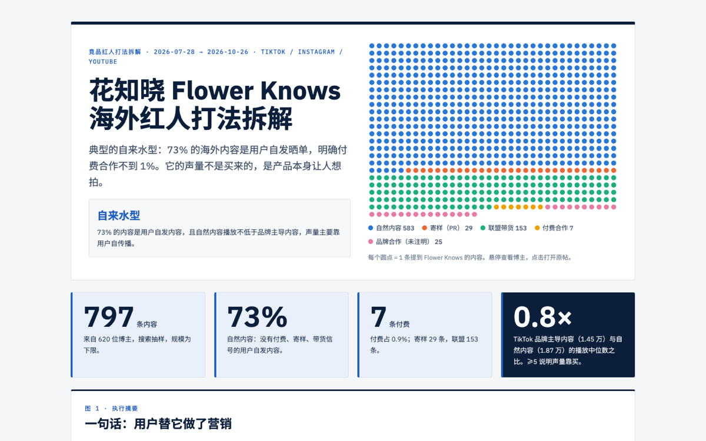
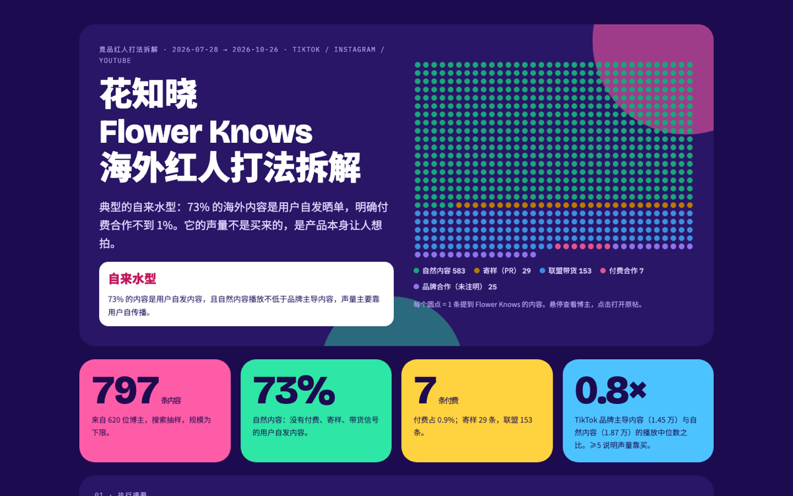
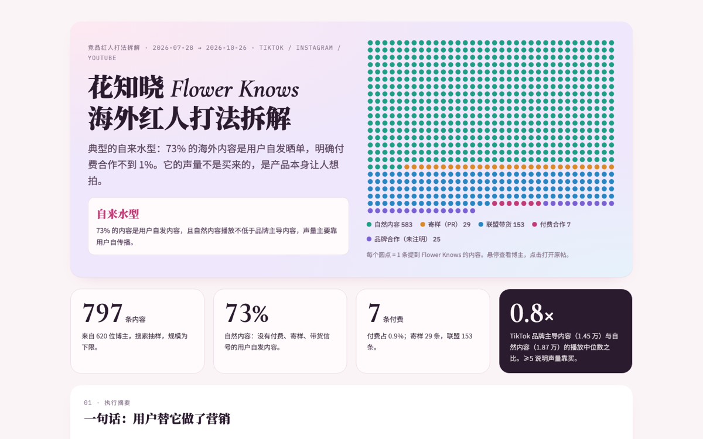
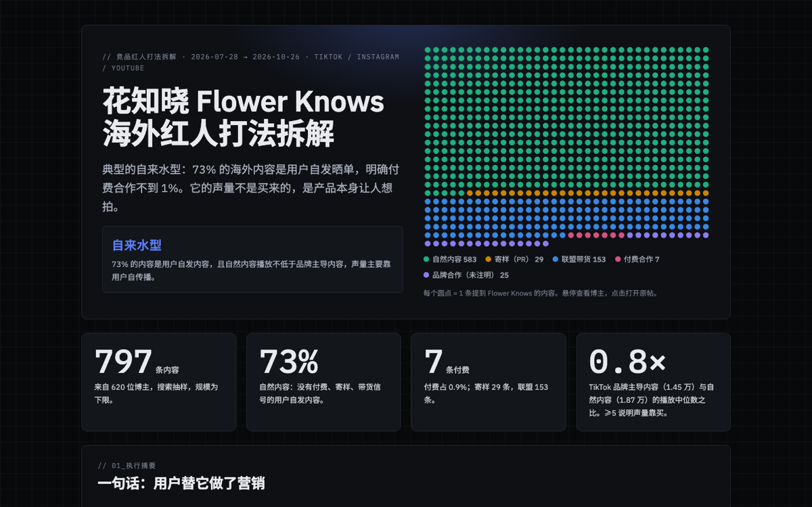
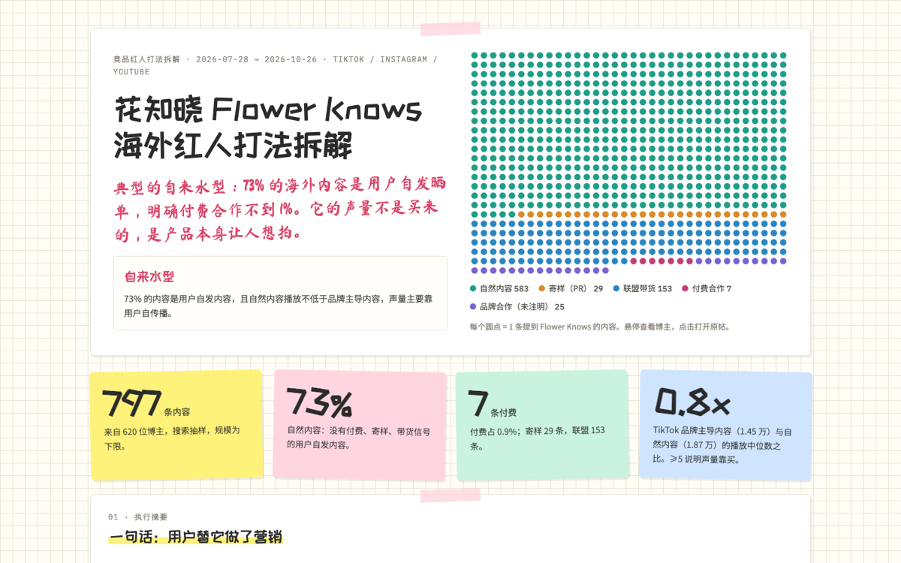

# 竞品红人投放雷达 · competitor-kol-radar

> AI Agent Skill —— 站在营销总监的角度，拆解竞品在 TikTok / Instagram / YouTube 上的红人营销打法

**兼容**：Claude Code · Codex · OpenCode 及其他支持 Skill 的 AI Agent

---

## 这是什么

给它一个品牌名，它会抓取这个品牌近 3 个月的海外红人与 UGC 内容，回答营销总监最关心的三个问题：

1. **它是怎么打的？** 买量型、自来水型、联盟铺量型还是混合型，依据是什么
2. **有没有用？** 付费、寄样、联盟、自然内容各占多少，哪类内容播放更高，博主是什么量级，大家在聊什么、夸什么，导向哪里成交
3. **我们该怎么办？** 每条发现都配"对我们意味着什么"，建议动作分"照搬 / 改造 / 避开 / 先小测"，带优先级、预算量级和验证指标

交付物是一个按 PC 端浏览排版的网页报告（5 种风格可选，手机上自动收成单列），外加一份可筛选的内容明细 CSV。

```
立项（决策问题）→ 写 brief → 成本预估 → 采集 → 清洗分类 → 人工抽查
→ 渠道与规模研究 → 统计分析 → 写结论 → 生成报告 → 更新对标库
```

## 为什么不只是"抓数据"

这个 Skill 的价值在于口径和判断，这些在实战里踩过坑才总结出来：

- **五类内容口径**：付费合作 / 寄样（PR）/ 联盟带货 / 品牌合作（未注明）/ 自然内容。文案信号优先，平台标记兜底
- **坑清单**：同名噪音、官方号和仿冒号、竞品赞助的对比视频、YouTube 简介里其他品牌的折扣码、美妆圈的"PR ≠ 付费"、IG 播放数据缺失、Similarweb 直接访问偏高……
- **打法画像判定**：用"品牌主导内容 vs 自然内容播放倍数""自然内容占比""联盟占商业内容比例"自动判定，结论可追溯
- **对标库**：每跑一个品牌自动沉淀核心指标，越用越能回答"它处在什么位置"

内置两个对标样本，正好是两个极端：

| 品牌 | 打法 | 自然内容占比 | 品牌主导 / 自然播放 |
|---|---|---|---|
| Plaud（AI 录音卡） | 买量型 | 61% | 153× |
| 花知晓 Flower Knows（彩妆） | 自来水型 | 73% | 0.8× |

---

## 5 种报告风格

同一份数据，按报告给谁看、发在哪，生成不同风格的网页。可以直接指定，也可以让 Agent 自动选。下图都是同一份花知晓报告的首屏。

| 咨询报告风 `consulting` | 年度回顾风 `wrapped` |
|---|---|
|  |  |
| 参考麦肯锡 / BCG：图表编号、结论式标题、每张图都有来源行。**给老板、客户、投资人汇报。** | 参考 Spotify Wrapped：大色块、超大数字。**社媒传播、录屏视频。** |

| 品牌调性风 `brand` | 暗黑科技风 `terminal` |
|---|---|
|  |  |
| 梦幻配色、衬线大字、蕾丝分隔线。**美妆、时尚、生活方式品牌。** | 参考 Linear / Vercel：近黑底、细线边框、等宽数字。**AI、SaaS、硬件、App。** |

| 小红书手账风 `notebook` | |
|---|---|
|  | 方格纸、便利贴、荧光笔标题、手写判词。**小红书图文和视频。** |

**自动选择规则**：用户点名 → `style` 字段 → 用途（汇报→咨询，社媒/视频→年度回顾，小红书→手账）→ 品类（美妆时尚→品牌调性，科技 App→暗黑科技）→ 默认咨询报告风。

```bash
python3 -I scripts/build_report.py --brief brief.json                  # 自动选
python3 -I scripts/build_report.py --brief brief.json --style notebook # 指定
```

所有风格的图表配色都经过色盲安全校验，支持浅色 / 深色模式（年度回顾风和暗黑科技风固定深色）。

---

## 快速上手

### 1. 把这句话复制给你的 AI Agent

```
帮我安装这个 Skill：https://github.com/waynefu2020/competitor-kol-radar
按仓库里 INSTALL.md 的步骤来。
```

Claude Code、Codex 等能操作电脑的 Agent 会自己完成下载、放到正确目录、自检。中途它会问你要 TikHub API Key：

- **有 Key**：直接发给它，它会帮你安全保存。到 [tikhub.io](https://tikhub.io) 注册就能拿到，一次海外调研大约 $0.5–1。
- **没有 Key**：告诉它"先不用"，它会改用免费兜底方案，数据少一些。

### 2. 对 AI 说一句话

```
帮我拆一下 Flower Knows 最近 3 个月的海外红人营销
```

其他说法：

- "竞品 XX 在 TikTok / IG / YouTube 上投了哪些博主？"
- "我们想出海，帮我看看对标品牌是怎么做红人营销的，做成给老板汇报的风格"
- "XX 的海外声量是买来的还是用户自发的？做成适合发小红书的风格"

<details>
<summary>技术用户：手动安装</summary>

```bash
git clone https://github.com/waynefu2020/competitor-kol-radar.git ~/.claude/skills/competitor-kol-radar
printf '%s' '你的 TikHub Key' | python3 ~/.claude/skills/competitor-kol-radar/scripts/doctor.py --save-key
python3 ~/.claude/skills/competitor-kol-radar/scripts/doctor.py
```

需要 Python 3.9+，无第三方依赖。Key 存在 `~/.config/tikhub/key`（也可用环境变量 `TIKHUB_API_KEY`），不要写进 Skill 目录或项目文件。其他 Agent 的目录见 [INSTALL.md](INSTALL.md)。

</details>

### 没有 TikHub 时的免费兜底

用 [Agent Reach](https://github.com/Panniantong/Agent-Reach) 的免费工具链（yt-dlp、xhs-cli、网页搜索）：

| 平台 | 兜底能力 |
|---|---|
| YouTube | 播放量、频道、简介；发布日期和订阅数需要浏览器登录态 |
| 小红书 | 赞藏评转、发布时间（需 `xhs login`） |
| TikTok | 靠网页搜索发现链接后逐条解析，有播放和发布时间，没有粉丝数，覆盖面窄 |
| Instagram | 只能读少量公开帖，仅做定性 |

报告会自动注明哪些数据来自兜底、缺了什么。详见 `references/fallback-agent-reach.md`。

---

## 目录结构

```
competitor-kol-radar/
├── SKILL.md                    流程与判断规则（Agent 读这个）
├── INSTALL.md                  安装说明（Agent 读这个）
├── scripts/
│   ├── collect.py              采集（--dry-run 预估成本和余额）
│   ├── normalize.py            清洗、去噪、五类分类、抽查样本
│   ├── analyze.py              KPI、打法画像、对标、CSV
│   ├── build_report.py         生成网页报告
│   ├── agent_reach_import.py   免费兜底：yt-dlp / xhs-cli 导入
│   ├── doctor.py               安装自检、保存 Key
│   ├── lexicons.py             美妆 / 科技 / App 的选题与卖点词典
│   ├── tikhub.py · common.py
├── references/
│   ├── methodology.md          口径、KPI、打法画像判定
│   ├── pitfalls.md             坑清单
│   ├── report-spec.md          总监视角的写作规范与 narrative.json 格式
│   ├── channel-signals.md      渠道信号怎么读
│   ├── platforms-overseas.md   TikHub 接口与字段
│   ├── platforms-domestic.md   国内平台（实验）
│   ├── fallback-agent-reach.md 没有 TikHub 时的免费兜底
│   └── benchmarks.json         对标库
├── assets/
│   ├── report_template.html    报告模板（5 种风格）
│   └── brief.example.json
├── examples/flowerknows/       样例 brief 与结论
└── docs/styles/                5 种风格截图
```

## 局限

- 数据是搜索抽样，不是全量；没披露的合作会被算进自然内容，付费规模视为下限
- TikTok 商业标记字段的含义是根据样本推断的
- 国内平台：小红书可通过 xhs-cli 导入，抖音暂未自动化
- 免费兜底方案的 TikTok 和 Instagram 数据不完整，适合摸底，不适合下强结论
- 公开报道的营收、估值口径常不一致，报告会并列标注

## License

MIT
